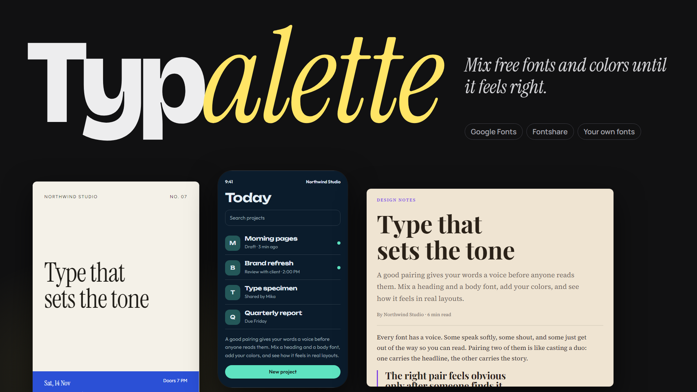
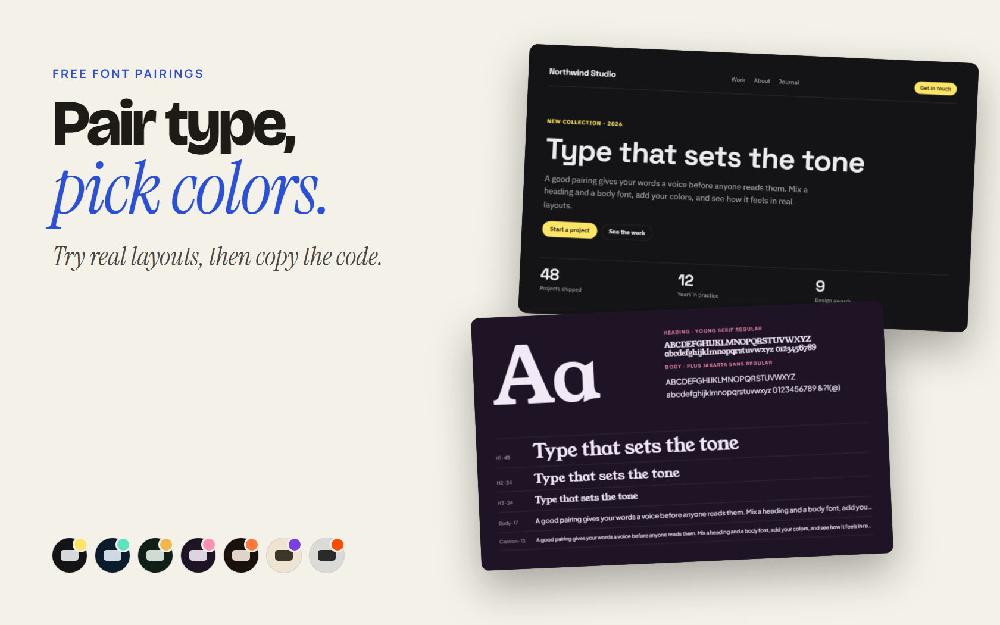

# Typalette

**Mix free fonts and colors until it feels right.**

## About

Typalette helps you pick fonts and colors for a project. Choose a heading font and a body font, add your colors, and see how they look in real layouts before you commit.

It is free, with no account. Every font is free to use, and your own fonts never leave your browser.

**[Try it: direkjames.github.io/Typalette](https://direkjames.github.io/Typalette/)**

## Features

- **Curated pairings:** 30 hand-picked heading and body combinations from Google Fonts and Fontshare, filtered by style (Modern, Elegant, Editorial, Techy, Playful and Bold)
- **Shuffle** for a new pairing (press **S**), and lock one font while you shuffle the other
- **Six live previews:** Website, Article, App screen, Poster, Business card and Specimen, using your own headline, text and brand name
- **Colors:** ten ready-made color sets, or choose your own background, text and accent, with a swap button and a contrast check for text and accent
- **Fine tuning:** font weights, size, line spacing and heading letter spacing
- **Your own fonts:** add .ttf, .otf, .woff or .woff2 files and they stay in your browser
- **Save combos** you like and compare up to three side by side
- **Share link** that opens exactly what you made
- **Get the code:** copy the `<head>` snippet and the CSS, ready to paste into your site

## Getting started

1. Open [direkjames.github.io/Typalette](https://direkjames.github.io/Typalette/) in your browser.
2. Press **Shuffle** or pick a pairing from the library.
3. Try the six previews, then choose your colors and adjust the sizing.
4. Press **Save** to keep it, **Share link** to send it, or **Get the code** to use it.

Fontshare fonts may show a stand-in font if you open `index.html` straight from your computer. They load normally once the page is on a website.

## Requirements

- A modern web browser (Chrome, Edge, Firefox or Safari)
- An internet connection, to load the fonts

## Built with

- HTML, CSS and JavaScript in a single file, with no build step
- Fonts from [Google Fonts](https://fonts.google.com) and [Fontshare](https://www.fontshare.com)

## Status

Shipped.

## Credits / License

Made by [direkjames](https://github.com/direkjames).

All rights reserved. See [LICENSE](LICENSE). Check each font's license page before using it in a product.
